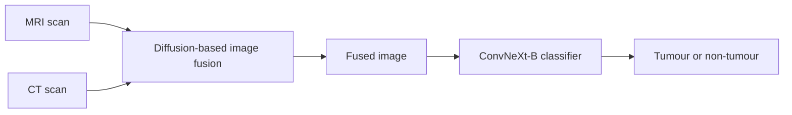

# NeuroFuse — Medical Image Fusion for Tumour Classification

NeuroFuse is a B.Tech major-project research repository for combining MRI and CT images before brain-tumour classification. The project explores whether a fused image can preserve useful detail from both modalities for a classifier.

## Method



- **Fusion:** a Diff-IF-based diffusion workflow produces a fused MRI/CT image.
- **Classification:** ConvNeXt-B predicts tumour or non-tumour from the fused output.
- **Interface:** a Streamlit application runs the fusion and classification flow for an input patient folder.

## Repository layout

- [`neurofuse/README.md`](neurofuse/README.md) — research summary and evidence.
- [`neurofuse/code/`](neurofuse/code/) — received implementation and provenance notes.
- [`neurofuse/ICCMA.md`](neurofuse/ICCMA.md) — publication and submission context.

## Run

The research code is located in `neurofuse/code/batch-04 code/Diffusion and classification/`. It depends on the Diff-IF environment, model weights, and paired input images; model weights are not stored in this repository. Review the provenance notes before setup, then run the Streamlit entry point:

```bash
streamlit run app.py
```

This is research software, not a clinical diagnostic tool.
